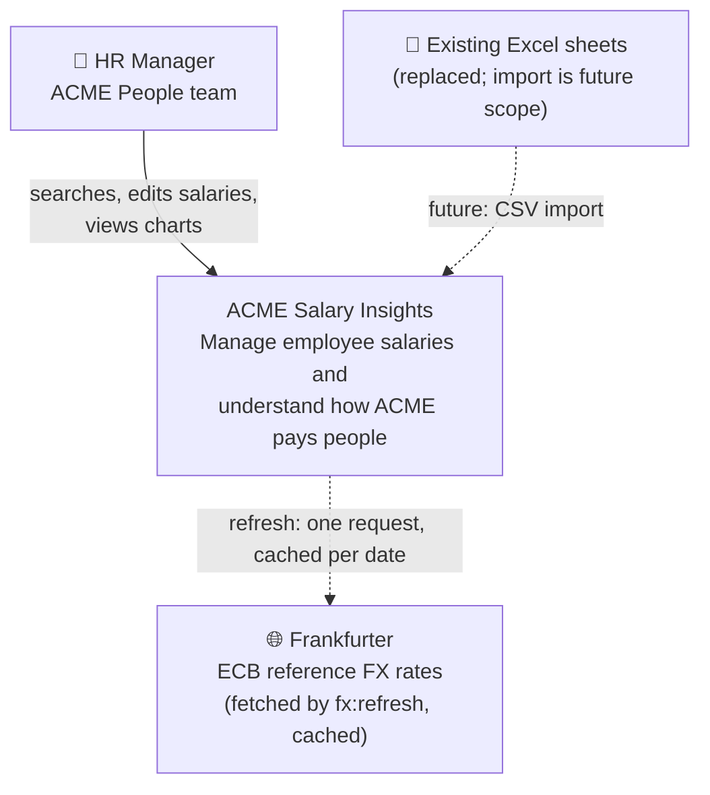
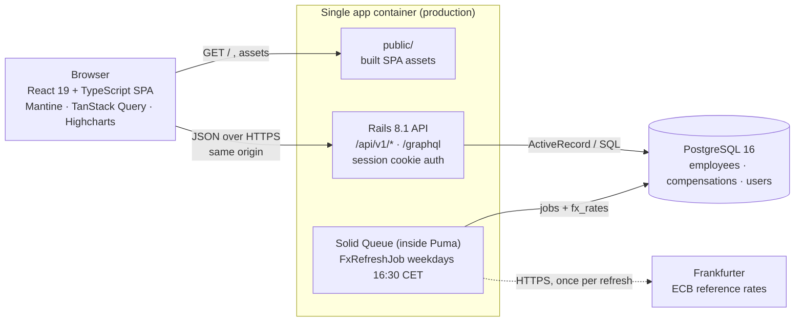
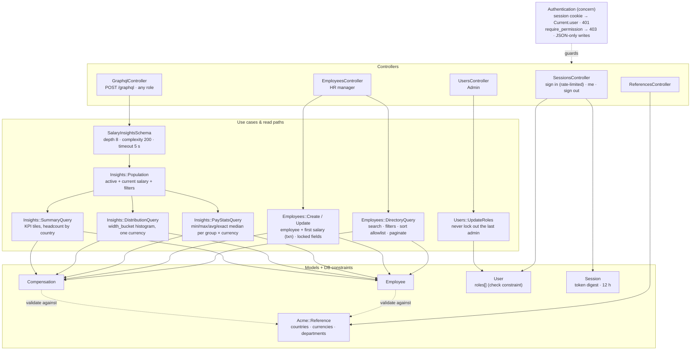
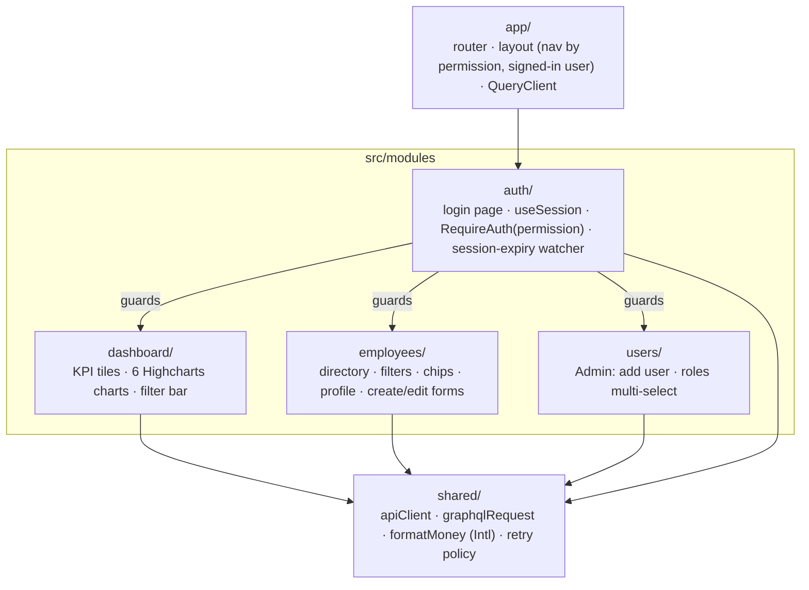
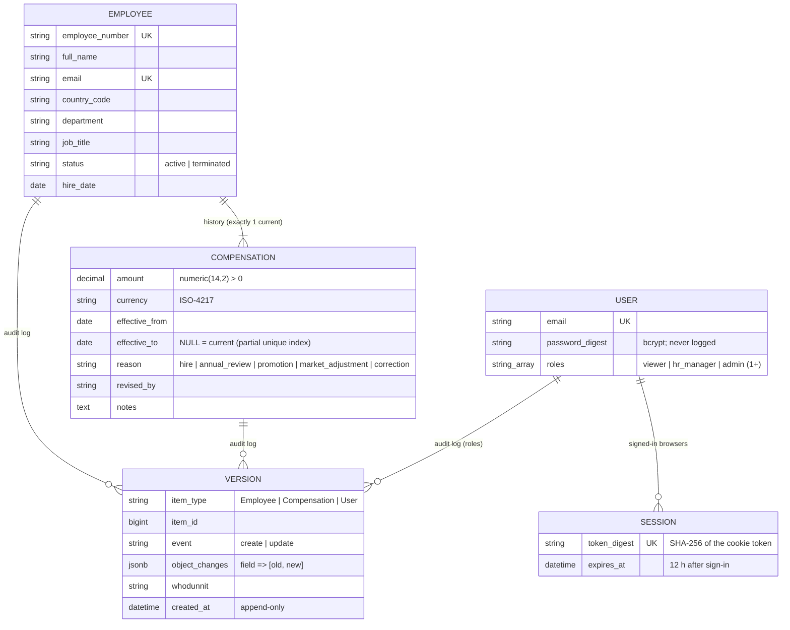
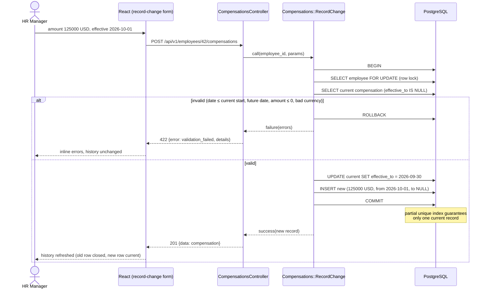
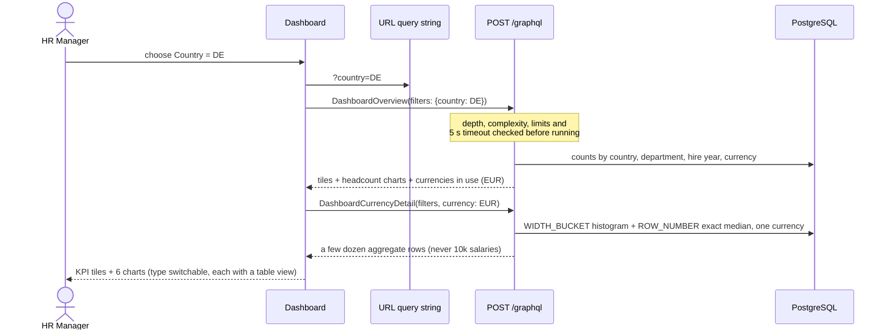
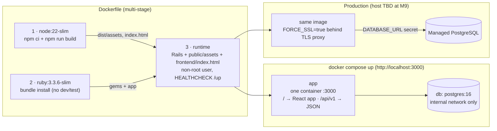
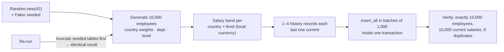

# Architecture diagrams

All diagrams are Mermaid, so GitHub renders them inline. Rendered SVG copies are in [`diagrams/`](diagrams/). Diagrams marked *(planned)* describe the design before implementation; they are updated if the build differs.

## 1. System context (C4 level 1)

Who uses the system, and what it talks to.

## 2. Containers (C4 level 2)

The deployable pieces and how they communicate.

## 3. Backend components (C4 level 3)

How a request flows through the Rails layers. Controllers stay thin: they parse params and choose the status code.

## 4. Frontend modules

Feature-first layout: each module owns its pages, hooks, types and tests.

## 5. Data model

## 6. Sequence: record a salary change (the critical write)

## 7. Sequence: filtered dashboard and charts (the critical read)

## 8. Build and deployment (one container; host chosen in M9)

## 9. Seed data flow

