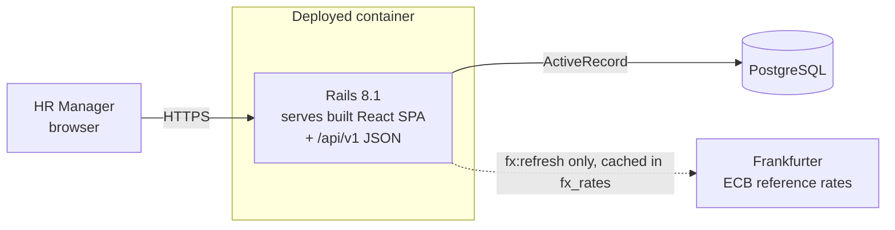

# Architecture

> Full diagram set (C4 context/containers/components, frontend modules, data model, sequences, deployment, seed flow): [`architecture-diagrams.md`](architecture-diagrams.md), with SVGs in [`diagrams/`](diagrams/). Planning, wireframes, risks and the test strategy are in [`planning-notes.md`](planning-notes.md).

## Shape: a modular monolith with two apps in one repository

| Layer | Responsibility | Choice |
|-------|----------------|--------|
| `frontend/` | Directory (search and filters), employee detail, salary form, insights dashboard | React 19 + TypeScript (Vite), Mantine components, TanStack Query for server state, **Highcharts** for charts (dashboard lazy-loaded), GraphiQL at `/graphiql`. Filter state is kept in the URL query string. |
| `backend/` | Validation, business rules, REST API, auth | Rails 8.1 API mode, thin controllers |
| Database | Integrity, filtering, aggregation | PostgreSQL 16 (exact median via `ROW_NUMBER` in numeric arithmetic; histograms via `WIDTH_BUCKET`) |
| Run locally (Docker) | Reproducible environment | Root `compose.yaml`: `db` + one `app` container, http://localhost:3000 |
| Production | One deployable unit | Root multi-stage `Dockerfile`: Node builds the React app; Rails serves `/api` **and** the app on one origin (hashed `/assets` cached for a year, `index.html` via `FrontendController` with `no-cache`) → **same origin, no CORS, cookie session** |
| Day-to-day development | Hot reload | Native `bin/rails s` (:3000) + `npm run dev` (:5173, proxies `/api`) |

Earlier three-container setup (M1), kept for reference: [`examples/before-single-container/`](examples/before-single-container/README.md).

## Backend structure (Rails conventions)
- **Models:** persistence and local invariants (`Employee`, `Compensation`), backed by DB constraints.
- **Services:** explicit multi-step use cases, e.g. `Compensations::RecordChange` (transaction + row lock).
- **Queries:** read paths, e.g. `Employees::DirectoryQuery` (filter/sort/paginate) and `Insights::PayStatsQuery` (aggregates).
- **Serializers:** plain Ruby `as_json` presenters. No serializer gem until one is needed.
- No observers and no business side effects in callbacks.

## Frontend structure (feature-first)
`src/modules/{dashboard,employees,compensation,insights}` each own their pages, components, API hooks, types and tests. `src/shared` holds the API client, formatting (money via `Intl.NumberFormat` with the record's currency) and layout.

## Key flows
1. **Directory:** `GET /api/v1/employees?q=&country=&page=` → `DirectoryQuery` → paginated JSON with `meta.total`.
2. **Salary change:** `POST /api/v1/employees/:id/compensations` → `RecordChange` locks the employee row, validates the date against the current record, closes it and inserts the new one inside **one transaction** → 201, or 422 with history untouched.
3. **Insights:** `POST /graphql` `dashboard(filters:)` → `Insights::*Query` objects run one SQL aggregate each, grouped by `(dimension, currency)` so currencies are never mixed.
4. **Charts (GraphQL):** the dashboard's filter bar updates the URL → one `DashboardOverview` query (tiles, headcount by country/department, hires by year) and one `DashboardCurrencyDetail` query for the chosen currency (distribution, pay by department and job title), both with the same filters → Highcharts draws six switchable charts. **All aggregation happens in SQL**: the browser receives at most a few dozen rows, never 10,000 salaries.
5. **Sign-in and access:** `POST /api/v1/session` → bcrypt check → a random token goes in an HttpOnly, SameSite=Lax cookie (its digest is stored in `sessions`) → every API/GraphQL request loads the session (401 if missing or expired) and checks the role's permission (403). The React app mirrors those permissions to hide links and buttons, but the server is the authority.
6. **Reporting currency (FX):** `FxRefreshJob` (Solid Queue recurring task, weekdays 16:30 Europe/Berlin, retried twice 30 min apart), `bin/rails fx:refresh` and container start each ask Frankfurter once for ECB rates and cache them in `fx_rates`. Solid Queue runs inside Puma and keeps its jobs in the same PostgreSQL database. `dashboard.converted(to:)` reads the latest cached snapshot (never the provider; each app process keeps the rates in memory and re-reads them only when a one-row version query, latest rate date + fetch time, changes), builds exact cross rates, converts each salary in SQL (`amount × factor` in numeric), then aggregates. Every converted chart shows each rate, its date and the source.

## Performance approach (10k employees)
- All filtering, sorting and pagination happens in SQL; no endpoint loads every employee.
- Planned indexes: `employees(employee_number)` unique; `employees(country_code, department, status)`; `compensations(employee_id) WHERE effective_to IS NULL` (unique partial index, which also enforces one current salary). Further indexes only after EXPLAIN on the 10k seed (M8).
- No caching until a measurement shows a need.

## Future domains (not built)
Paystubs, employee documents and employee lifecycle may become separate modules or services. They are documented only; the MVP has no dependency on them.
