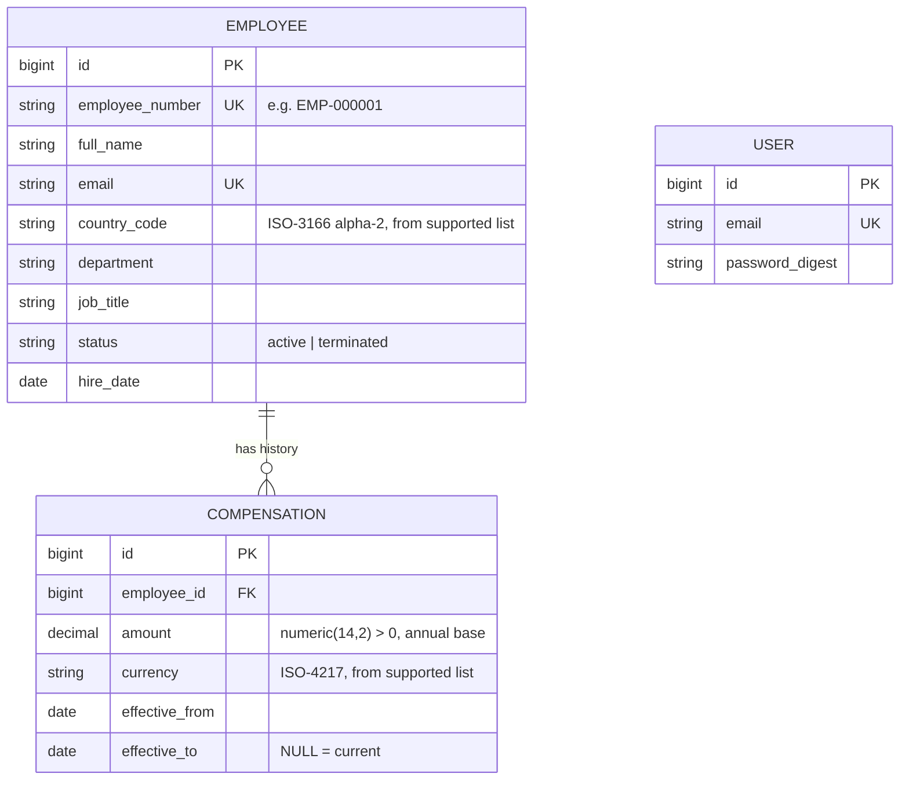

# Domain model

Countries, currencies and departments are a **small, static, code-level list** (`Acme::Reference`) rather than tables. They change rarely, need no admin UI in the MVP, and the list stays validated in one place. If HR needs to manage them, they get promoted to tables later.

## Invariants (and where each is enforced)
| Invariant | Model validation | DB constraint | Test |
|-----------|------------------|---------------|------|
| Employee number unique | ✓ | unique index | model + request |
| Amount > 0, decimal | ✓ | `CHECK (amount > 0)`, numeric(14,2) | model |
| Currency is supported ISO code | ✓ | `NOT NULL` | model |
| `effective_to` ≥ `effective_from` when present | ✓ | `CHECK` | model |
| **At most one current record per employee** | service | **unique partial index** `WHERE effective_to IS NULL` | service (incl. concurrency-safe lock) |
| New change starts after current start and not in the future | service | — | service |
| Change is atomic | service transaction | — | rollback spec |
| Never aggregate across currencies | query groups by currency | — | insights spec with mixed currencies |
